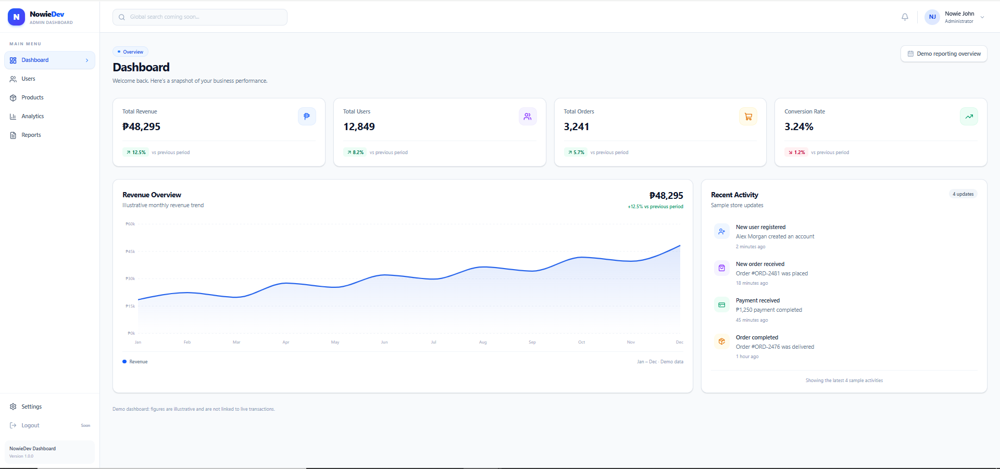
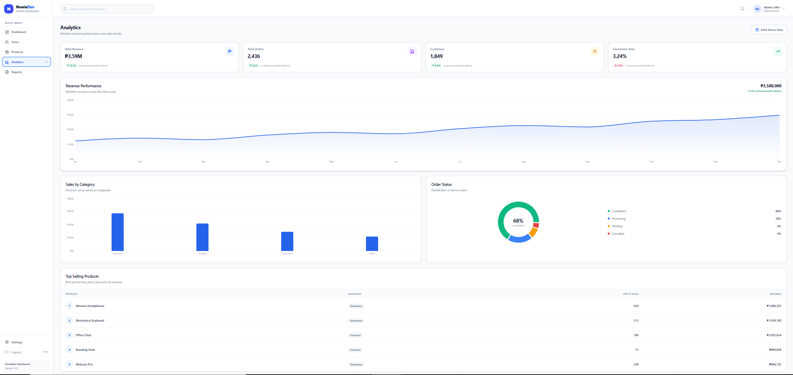
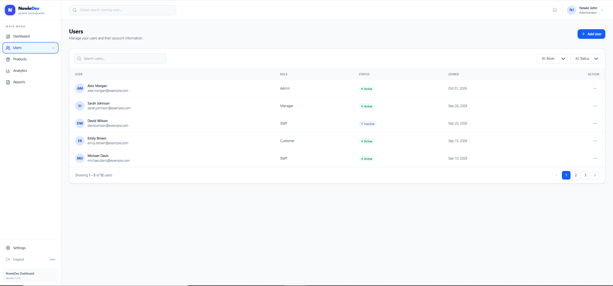
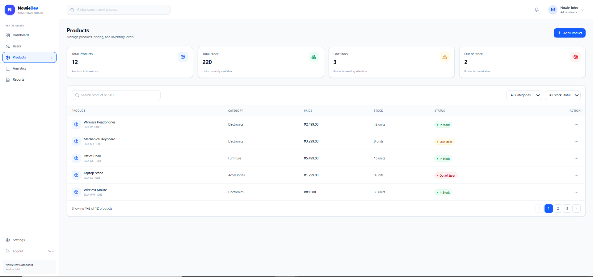
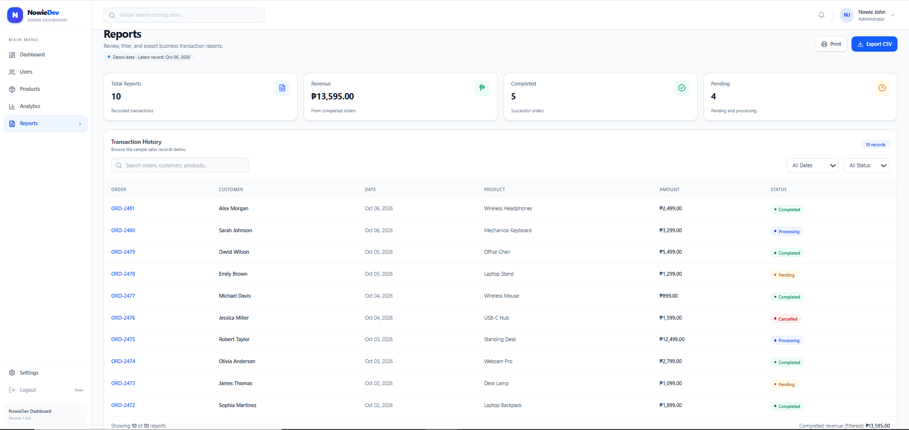
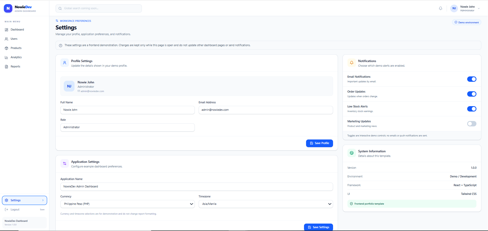
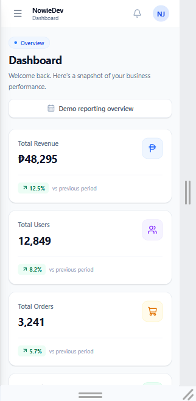

# NowieDev Admin Dashboard

A modern, responsive admin dashboard built with React, TypeScript, Vite, and Tailwind CSS.


## Live Demo

**[View Live Dashboard](https://react-admin-dashboard-three-psi.vercel.app/)**

Explore the dashboard's responsive layout, analytics, user management, product inventory, reports, and settings.

> This is a frontend portfolio demonstration using sample data. Changes are not permanently saved.


This project showcases frontend development skills through dashboard interfaces, data visualization, user management, product inventory, reports, and application settings.

## Features

- **Dashboard:** KPI cards, charts, and recent activity.
- **Analytics:** Business metrics and interactive charts.
- **Users:** Add, edit, delete, search, filter, and paginate user records.
- **Products:** Product management, inventory tracking, pricing, and stock status.
- **Reports:** Transaction records, search and filters, CSV export, and printable reports.
- **Settings:** Profile settings, application preferences, and notification controls.
- **Responsive Design:** Supports desktop, tablet, and mobile layouts.

## Tech Stack

- React
- TypeScript
- Vite
- Tailwind CSS
- React Router
- Recharts
- Lucide React

## Getting Started

### Prerequisites

- Node.js
- npm

### Installation

Clone the repository:

```bash
git clone https://github.com/nowiedev/react-admin-dashboard.git
cd react-admin-dashboard
```

Install dependencies:

```bash
npm install
```

Start the development server:

```bash
npm run dev
```

### Production Build

```bash
npm run lint
npm run build
npm run preview
```


## Screenshots

### Dashboard


### Analytics


### User Management


### Product Management


### Reports


### Settings


### Mobile View



## Project Status

This is a frontend portfolio project using demonstration data.

User and product operations use React state and are not permanently stored. Settings are also demonstration-only.

Backend authentication, database integration, and live business data are not included in this version.

## Future Improvements

- Backend API and database integration
- User authentication and role-based access
- Persistent data storage
- Global search functionality
- Real-time notifications
- Additional analytics and reporting

## Author

**NowieDev**

GitHub: https://github.com/nowiedev
